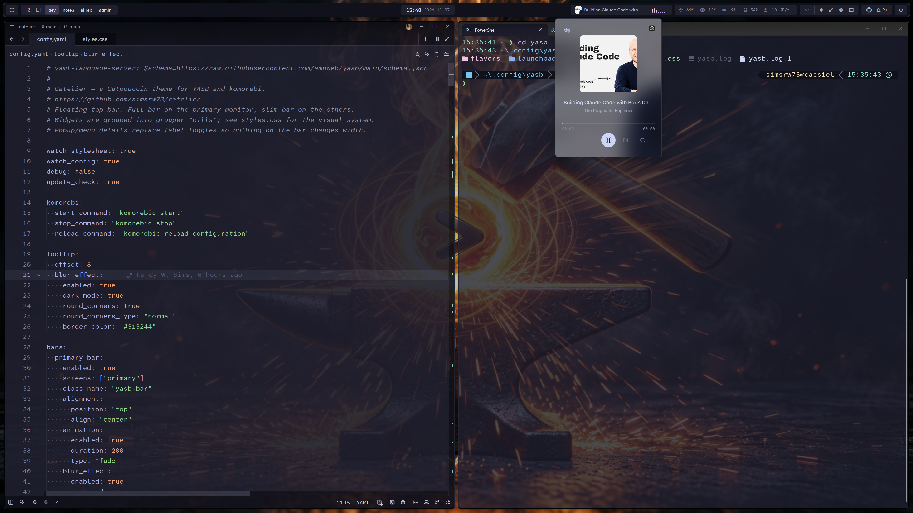
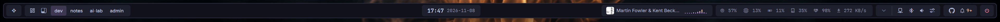
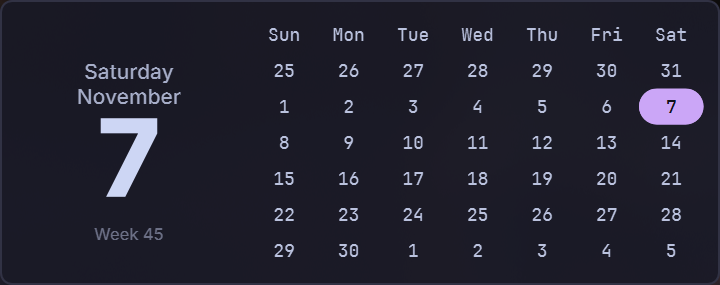
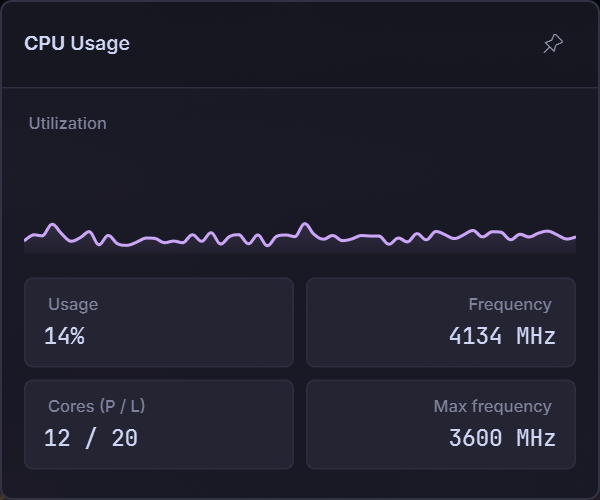
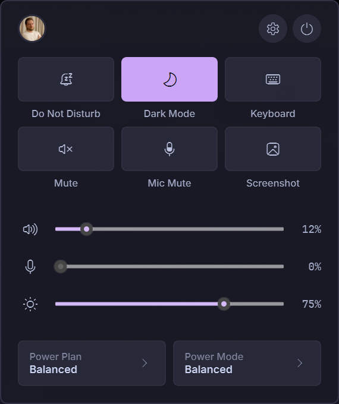

# Catelier

A quiet command center for [YASB](https://github.com/amnweb/yasb) (Yet Another Status Bar) on Windows: compact, orderly and information-rich, with enough restraint to stay out of your way while you work. It's built on the [Catppuccin](https://catppuccin.com/) palettes and set up for the [komorebi](https://github.com/LGUG2Z/komorebi) tiling window manager. It also styles [GlazeWM](https://github.com/glzr-io/glazewm), if you prefer that.

It comes in all four flavors (Latte, Frappé, Macchiato and Mocha) with your choice of accent color, and optional translucency.

The name is Catppuccin plus *atelier*, French for an artist's studio. This is not an official Catppuccin port.





## Design

Important information is brighter and heavier so it catches your eye; everything else is quieter and recedes. Related information and controls sit together, so the bar is quick to scan.

- **A floating top bar of pills.** Widgets are grouped into rounded pills: launcher, window manager, active window, clock, media, system metrics, controls, status and power.
- **Three levels of emphasis.** The time, focused workspace and active window title use the brightest text. Media, controls and status icons are a step dimmer. Metrics are dimmest, so they're there when you look and quiet when you don't.
- **Color means state.** The accent color (mauve by default) marks focus, peach marks something waiting for you (GitHub notifications), and red marks a critical reading or the power button. Everything else is neutral.
- **Nothing on the bar changes width.** Numbers use a monospace font with fixed minimum widths, and details open in popups instead of swapping labels.
- **One look for every popup.** Calendar, CPU, memory, GPU, network, disk, drive health, Wi-Fi, Bluetooth, volume, media, control center, GitHub, system tray and power menu all share the same surfaces, spacing and buttons.

<p>
  
  
  
</p>

**Latte is adjusted for contrast.** Catppuccin's dim grays are too faint on a light background, so in Latte the bar and popups use the lightest shades and each text level is one step darker. Colors still come only from the Catppuccin palette.

On the primary monitor you get the full bar. Other monitors get a slim bar with the launcher, workspaces, active window and clock.

## Requirements

- [YASB](https://github.com/amnweb/yasb) 2.0.7 or later
- [komorebi](https://github.com/LGUG2Z/komorebi) for the workspace, layout and stack widgets. Without it they hide themselves and the rest of the bar still works. To use [GlazeWM](https://github.com/glzr-io/glazewm) instead, see [Using GlazeWM](#using-glazewm).
- Fonts: nothing extra. Catelier uses JetBrainsMono Nerd Font, which YASB's setup installs, plus fonts that come with Windows 11 (Segoe UI Variable, Segoe Fluent Icons and Cascadia Mono). If you have [Inter](https://rsms.me/inter/), text uses it; otherwise it falls back to Segoe UI Variable.
- Optional: [LibreHardwareMonitor](https://github.com/LibreHardwareMonitor/LibreHardwareMonitor) for the drive health widget. See [Drive health](#drive-health).

## Install

Run this in PowerShell to install the default, Mocha with a mauve accent and a solid bar:

```powershell
irm https://raw.githubusercontent.com/simsrw73/catelier/main/install.ps1 | iex
```

To choose a flavor, accent or translucency, pass `-Flavor`, `-Accent` or `-Translucency`:

```powershell
& ([scriptblock]::Create((irm https://raw.githubusercontent.com/simsrw73/catelier/main/install.ps1))) -Flavor macchiato -Accent mauve -Translucency medium
```

- `-Flavor`: `latte`, `frappe`, `macchiato` or `mocha` (default)
- `-Accent`: any of the 14 Catppuccin accents: `rosewater`, `flamingo`, `pink`, `mauve`, `red`, `maroon`, `peach`, `yellow`, `green`, `teal`, `sky`, `sapphire`, `blue` or `lavender`. Without it you get mauve. In Latte, lavender is too pale to read well, so pick a darker accent there.
- `-Translucency`: `off` (default), `subtle`, `medium` or `strong`. How much of the blurred desktop shows through the bar. See [Translucency](#translucency).

The script copies `config.yaml`, `styles.css` and the `flavors` folder into your YASB config folder (`%YASB_CONFIG_HOME%`, or `%USERPROFILE%\.config\yasb` if that isn't set). It backs up your existing `config.yaml` and `styles.css` first, as `config.yaml.<timestamp>.bak` and `styles.css.<timestamp>.bak`. Run it again any time to switch flavor, accent or translucency.

To keep your own `config.yaml` and only take the styles, clone the repository and run:

```powershell
.\install.ps1 -StylesOnly
```

Only the widgets in Catelier's config are styled, so you may need to adjust class names in your own config.

To install by hand, copy `config.yaml`, `styles.css` and the `flavors` folder into your YASB config folder and restart YASB.

## Customize

### Flavor and accent by hand

The installer does this for you. To do it yourself:

1. In `styles.css`, change the file name in `@import "flavors/mocha.css";` to `latte.css`, `frappe.css` or `macchiato.css`.
2. In `config.yaml`, a few popup colors are written as Mocha hex values. Replace each with the same color from your flavor's file in `flavors/`: `#313244` is `surface0`, `#9399b2` is `overlay2` (use `subtext0` in Latte) and `#fab387` is `peach`. For Latte, also change every `dark_mode: true` to `dark_mode: false`.
3. For a different accent, change both `--accent` lines near the top of `styles.css`, for example to `var(--blue)` and `var(--blue-rgb)`. `var(--flavor-accent)` and `var(--flavor-accent-rgb)` give the flavor's default.

### Using GlazeWM

The config uses komorebi, and `styles.css` also styles YASB's GlazeWM widgets: workspaces, tiling direction and binding mode. To switch, replace the komorebi widgets in `config.yaml` with the GlazeWM ones. [docs/glazewm.md](docs/glazewm.md) has the exact changes, ready to paste. To update Catelier later without undoing the swap, run the installer with `-StylesOnly`, which leaves your `config.yaml` alone.

### Translucency

With translucency on, the blurred desktop shows through the bar. The pills keep more of their color than the bar, so the text on them stays readable over a bright wallpaper. Popups stay nearly solid.

The installer's `-Translucency` option sets two numbers near the top of `styles.css`. To set them yourself:

| Level | `--bar-glass` | `--pill-glass` |
| --- | --- | --- |
| Off (default) | 1 | 1 |
| Subtle | 0.6 | 0.8 |
| Medium | 0.4 | 0.7 |
| Strong | 0.2 | 0.6 |

It needs **Transparency effects** turned on in Windows **Settings → Personalization → Colors**, and `blur_effect` enabled for the bar in `config.yaml`, as it is in Catelier's config. Without the blur, the desktop shows through sharp, which makes the bar harder to read.

### Fonts

Change `--font-text`, `--font-mono` and `--font-icon` at the top of `styles.css`. Each is a list, and YASB uses the first font in it that's installed.

### Drive health

The drive health widget reads SSD health and drive temperatures from LibreHardwareMonitor. Without it, the widget shows `--`. To set it up:

1. Run LibreHardwareMonitor as administrator, and turn on **Options → Remote Web Server → Run**.
2. Open <http://localhost:8085/data.json> and find the `SensorId` values for your drives, such as `/nvme/0/temperature/0`. Each sensor in `data.json` has a `Text` name, so look for the health or life value and the temperatures.
3. In `config.yaml`, under `ssd_health`, set `sensor_id` to the sensor shown on the bar, and edit the `sensors` list for the popup. The sensor IDs in the theme are placeholders.

If you don't want the widget, remove `"ssd_health"` from the `metrics` group in `config.yaml`.

### Other widgets

- **Disk:** the disk widget shows drive `C`. To list more drives in its popup, add them to `volume_labels` under the `disk` widget, for example `["C", "D"]`.
- **GitHub:** the GitHub widget signs in with OAuth the first time you open it. It's hidden until you have unread notifications.

## Related

Catelier is the bar in my own desktop setup. These are the projects around it:

- **[dotfiles-windows](https://github.com/simsrw73/dotfiles-windows)**: My whole Windows setup, managed with chezmoi: `~/.config`, the PowerShell profile, apps, keys and secrets. The other projects here are either used by it or published from it.
- **[w11dwm-config](https://github.com/simsrw73/w11dwm-config)**: The keyboard-driven tiling desktop (komorebi, AutoHotkey, yasb, Flow Launcher, wpm), copied out of dotfiles-windows to share and discuss. Its key bindings, app launcher and window switcher are built on Legend.ahk.
- **[Legend.ahk](https://github.com/simsrw73/Legend.ahk)**: An AutoHotkey v2 library: an Alt+/ overlay of the shortcuts for the app you're in, which-key style chord menus, pickers and a window switcher. It runs the keys in w11dwm-config and dotfiles-windows.
- **[DotForge](https://github.com/simsrw73/DotForge)**: A PowerShell module that installs and configures command-line tools: XDG paths, fzf pickers, completions, shell hooks. The PowerShell profile in dotfiles-windows loads it, and it sets up Starship to read the starship-p9cat config.
- **[starship-p9cat](https://github.com/simsrw73/starship-p9cat)**: A Starship prompt in the powerlevel9k style, in Catppuccin colors. It's the prompt in dotfiles-windows, and a port of the CatPow theme from poshcat.omp.
- **[poshcat.omp](https://github.com/simsrw73/poshcat.omp)**: Catppuccin themes for Oh My Posh, including CatPow, a powerlevel10k-style theme. It was my prompt before Starship; starship-p9cat carries CatPow over.
- **[zenppuccin](https://github.com/simsrw73/zenppuccin)**: A Catppuccin theme for Zen Browser, in all four flavors with your choice of accent and optional translucency.

## Credits

Colors are from [Catppuccin](https://github.com/catppuccin/catppuccin), which is MIT-licensed. See [LICENSE](LICENSE).
